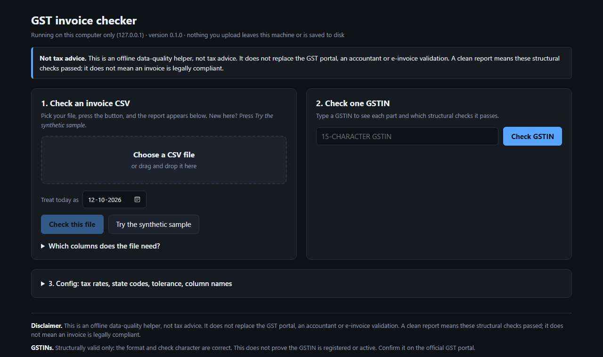
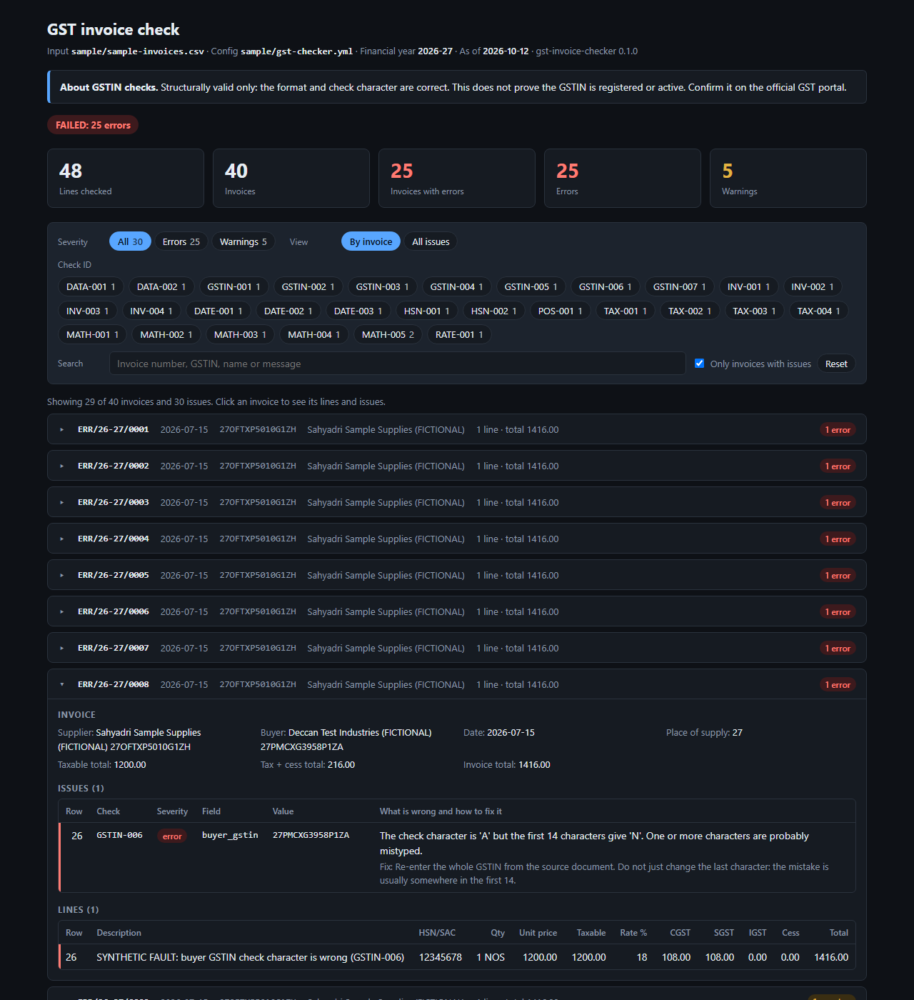
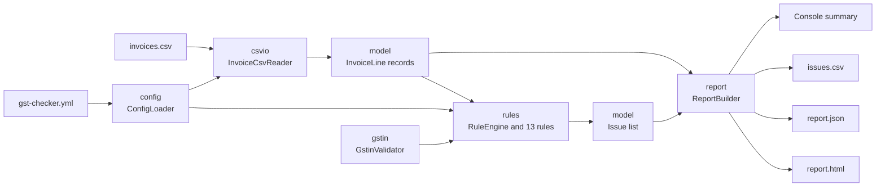

# gst-invoice-checker

[](https://github.com/Omkar210404/GST-Invoice-Checker/actions/workflows/ci.yml)
[](LICENSE)

A Java tool that checks a CSV of invoice lines against structural Indian GST rules and tells you, row by row, what is wrong and how to fix it. Use it from the command line, or open its local page in a browser, pick a file and press a button. It runs fully offline: it never contacts the GST portal or any other service.

> **Disclaimer.** This is an offline data-quality helper, not tax advice. It does not replace the GST portal, an accountant or e-invoice validation. A clean report means these structural checks passed; it does not mean an invoice is legally compliant.
>
> **GSTINs.** A GSTIN that passes is structurally valid only: the format and check character are correct. That does not prove the number is registered or active. Confirm it on the official GST portal.



*The local page (`ui` command), served from your own computer.*



*The HTML report for the bundled synthetic sample. The invoice shown was opened by a script for the screenshot; nothing else was altered. [The top of the same report](docs/report-overview.png) lists how often each check fired.*

## The problem it solves

Invoice data usually reaches a filing or an ERP import as a spreadsheet export, and small mistakes in it are expensive to find late: a GSTIN with two characters swapped, an invoice number one character too long, IGST charged on a sale within the state, a tax amount that is ten rupees off. This tool finds that class of mistake before the data goes anywhere.

It reads one CSV, applies 29 checks, and produces a console summary plus three report files. Each issue has a check ID, a severity, a plain-English message and a suggested fix. The exit code says whether errors were found, so it can gate a script or a CI job.

## Quick start

You need Java 21 or newer. Nothing else: the Maven Wrapper in this repo downloads Maven itself.

```bash
git clone https://github.com/Omkar210404/GST-Invoice-Checker.git
cd GST-Invoice-Checker
./mvnw package            # Windows: mvnw.cmd package
```

That produces `target/gst-invoice-checker-0.1.0.jar`, a single runnable JAR. Tagged versions also get the JAR attached to a GitHub release by the release workflow.

### The quick way: the local page

```bash
java -jar target/gst-invoice-checker-0.1.0.jar ui
```

```text
gst-invoice-checker is running at:

  http://127.0.0.1:8765/

Open that address in a browser on this computer. It is not reachable from any
other machine, and nothing you upload leaves this computer or is saved to disk.
Press Ctrl+C to stop.
```

Your browser opens on that address. Choose a CSV and press **Check this file**, or press **Try the synthetic sample** to see a report straight away. More under [`ui`](#ui-check-files-in-the-browser).

### From the command line

The repo includes a synthetic sample in [sample/](sample/). Check it:

```bash
java -jar target/gst-invoice-checker-0.1.0.jar check sample/sample-invoices.csv --config sample/gst-checker.yml --as-of 2026-10-12 --max-issues 6
```

`--as-of` pins "today" so the output below can be reproduced; leave it out for normal use. This is the real output:

```text
gst-invoice-checker 0.1.0
Input:   sample/sample-invoices.csv
Config:  sample/gst-checker.yml
Year:    2026-27   As of: 2026-10-12

+----------------------+-------+
| Summary              | Count |
+----------------------+-------+
| Lines checked        |    48 |
| Invoices             |    40 |
| Invoices with errors |    25 |
| Lines with issues    |    29 |
| Errors               |    25 |
| Warnings             |     5 |
+----------------------+-------+

+-----------+----------+-------+--------------------------------------------------------+
| Check     | Severity | Count | What it means                                          |
+-----------+----------+-------+--------------------------------------------------------+
| DATA-001  | error    |     1 | Required value is missing                              |
| DATA-002  | error    |     1 | Value is not a plain decimal number                    |
| GSTIN-001 | error    |     1 | GSTIN is not 15 letters and digits                     |
| GSTIN-002 | error    |     1 | GSTIN state code is not in the configured list         |
| GSTIN-003 | error    |     1 | GSTIN characters 3 to 12 are not PAN-shaped            |
| GSTIN-004 | error    |     1 | GSTIN entity number (character 13) is not valid        |
| GSTIN-005 | error    |     1 | GSTIN character 14 is not Z                            |
| GSTIN-006 | error    |     1 | GSTIN check character does not match                   |
| GSTIN-007 | warning  |     1 | GSTIN has lower-case letters or surrounding spaces     |
| INV-001   | error    |     1 | Invoice number is longer than 16 characters            |
| INV-002   | error    |     1 | Invoice number has characters that are not allowed     |
| INV-003   | error    |     1 | Invoice number reused with different invoice details   |
| INV-004   | warning  |     1 | Invoice numbers differ only by letter case             |
| DATE-001  | error    |     1 | Invoice date is not a valid date                       |
| DATE-002  | error    |     1 | Invoice date is in the future                          |
| DATE-003  | error    |     1 | Invoice date is outside the configured financial year  |
| HSN-001   | error    |     1 | HSN/SAC is not digits only                             |
| HSN-002   | error    |     1 | HSN/SAC length is not allowed                          |
| POS-001   | error    |     1 | Place of supply is not a configured state code         |
| TAX-001   | error    |     1 | IGST charged on an intra-state supply                  |
| TAX-002   | error    |     1 | CGST/SGST charged on an inter-state supply             |
| TAX-003   | error    |     1 | IGST mixed with CGST/SGST on one line                  |
| TAX-004   | error    |     1 | CGST and SGST are not equal                            |
| MATH-001  | error    |     1 | Tax amount does not equal taxable value x rate         |
| MATH-002  | error    |     1 | Line total does not equal taxable value + taxes + cess |
| MATH-003  | warning  |     1 | Taxable value does not equal quantity x unit price     |
| MATH-004  | error    |     1 | Negative amount                                        |
| MATH-005  | warning  |     2 | Zero amount                                            |
| RATE-001  | error    |     1 | Rate is not in the configured slab list                |
+-----------+----------+-------+--------------------------------------------------------+

First 6 of 30 issues (the rest are in the reports):
  row 19  DATA-001  error  ERR/26-27/0001
      'hsn_or_sac' is empty but is required on every line.
  row 20  DATA-002  error  ERR/26-27/0002
      '1,200.00' in taxable_value is not a plain decimal number.
  row 21  GSTIN-001  error  ERR/26-27/0003
      The GSTIN has 14 characters. It should have exactly 15.
  row 22  GSTIN-002  error  ERR/26-27/0004
      State code '99' is not in the list of state codes in the config.
  row 23  GSTIN-003  error  ERR/26-27/0005
      Characters 3 to 12 'AB1XD1234E' are not PAN-shaped (5 letters, then 4 digits, then 1
      letter).
  row 24  GSTIN-004  error  ERR/26-27/0006
      Character 13 (the entity number) is '0'. It should be 1 to 9 or A to Z.

Result: FAILED - 25 error(s), 5 warning(s)

Note: Structurally valid only: the format and check character are correct. This does not
prove the GSTIN is registered or active. Confirm it on the official GST portal.
Note: This is an offline data-quality helper, not tax advice. It does not replace the
GST portal, an accountant or e-invoice validation. A clean report means these structural
checks passed; it does not mean an invoice is legally compliant.

Reports written:
  reports/issues.csv
  reports/report.json
  reports/report.html
```

The process exits with code 1. The sample fails on purpose: after 17 clean lines it has one deliberately broken invoice for each check, so you can see what every check reports.

## Commands

### `ui`: check files in the browser

```text
java -jar gst-invoice-checker.jar ui [--port PORT] [--no-open]
```

The page has three parts:

1. **Check an invoice CSV.** Choose or drag in a file and press the button. The verdict, the counts and the full report appear on the page, with links to download `issues.csv`, `report.json` and `report.html`.
2. **Check one GSTIN.** Type a number to see its parts and which structural checks it passes.
3. **Config.** The rates, state codes, tolerances and column names both checks use, editable in the page. It starts as the example config; load your own YAML file or edit it in place.

Adding `#sample` to the address (`http://127.0.0.1:8765/#sample`) runs the synthetic sample as soon as the page opens.

| Option | Meaning |
|---|---|
| `-p`, `--port PORT` | Port to listen on. Default: 8765. `0` picks a free one. |
| `--no-open` | Do not open the browser automatically. |

**What "local" means here.** The tool still never contacts another machine. To show a page it has to listen for your browser, and it does that on the loopback address `127.0.0.1` only, which other computers cannot reach. It also refuses requests that are not addressed to this computer, and requires a random token that only the page it served knows, so another website open in your browser cannot use it. Uploaded files are checked in memory, never written to disk, and gone when you stop the tool. Only the eight most recent reports are kept. A build test fails if any code could open an outbound connection or listen on anything but the loopback address.

The page is meant for your own machine. It is not designed to be exposed on a network, and it is not available through the Docker image.

### `check`: validate a file

```text
java -jar gst-invoice-checker.jar check FILE [--config FILE] [--out-dir DIR]
                                             [--as-of YYYY-MM-DD] [--strict] [--max-issues N]
```

| Option | Meaning |
|---|---|
| `-c`, `--config FILE` | YAML config. Default: `gst-checker.yml` in the current folder. There is no built-in fallback, on purpose: the allowed rates must come from a file you have checked. |
| `-o`, `--out-dir DIR` | Where to write `issues.csv`, `report.json` and `report.html`. Default: `reports`. |
| `--as-of YYYY-MM-DD` | The date to treat as today when checking for future dates. Default: the system date. |
| `--strict` | Exit with code 1 on warnings as well as errors. |
| `--max-issues N` | How many issues to list on the console. Default: 15. The report files always contain all of them. |

### `gstin`: check one GSTIN and explain the result

```bash
java -jar target/gst-invoice-checker-0.1.0.jar gstin 29SSKXS4484U1ZB
```

```text
GSTIN: 29SSKXS4484U1ZB

  Characters 1-2    29          State code: 29 Karnataka
  Characters 3-12   SSKXS4484U  PAN-shaped part
  Character 13      1           Entity number
  Character 14      Z           Fixed character
  Character 15      B           Check character

Checks
  [PASS] GSTIN-001  15 characters, only A-Z and 0-9
  [PASS] GSTIN-002  State code (characters 1-2)
  [PASS] GSTIN-003  PAN-shaped part (characters 3-12)
  [PASS] GSTIN-004  Entity number (character 13)
  [PASS] GSTIN-005  Fixed character Z (character 14)
  [PASS] GSTIN-006  Check character (character 15)
  [PASS] GSTIN-007  Upper case with no spaces

Result: STRUCTURALLY VALID

Note: Structurally valid only: the format and check character are correct. This does not prove the GSTIN is registered or active. Confirm it on the official GST portal.
Note: state codes came from the built-in example list, which you should verify.
```

That number is synthetic: it comes from the sample file and belongs to nobody. Change one character and the check character no longer matches. The command exits with code 1, and its output ends like this:

```bash
java -jar target/gst-invoice-checker-0.1.0.jar gstin 29SSKQS4484U1ZB
```

```text
  [FAIL] GSTIN-006  Check character (character 15)
         The check character is 'B' but the first 14 characters give 'P'. One or more characters are probably mistyped.
         Fix: Re-enter the whole GSTIN from the source document. Do not just change the last character: the mistake is usually somewhere in the first 14.
  [PASS] GSTIN-007  Upper case with no spaces

Result: NOT VALID

Note: This GSTIN is malformed. Remember that even one that passes is only structurally valid: passing does not prove a GSTIN is registered or active.
```

Pass `--config FILE` to take the state code list from your own config instead of the built-in example.

### `sample`: write synthetic data to try the tool

```bash
java -jar target/gst-invoice-checker-0.1.0.jar sample --dir demo
```

```text
Wrote SYNTHETIC sample data (fictional companies, generated GSTINs):
  demo/sample-invoices.csv
  demo/gst-checker.yml
  demo/SAMPLE-README.txt

Try it:
  java -jar gst-invoice-checker.jar check demo/sample-invoices.csv --config demo/gst-checker.yml

The rate list and state list in the config are examples. Verify them against official GST notifications before checking real data.
```

The default folder is `sample`. Existing files are not overwritten unless you pass `--force`. `--seed N` changes the generated GSTINs; the same seed always gives the same files.

### Exit codes

| Code | Meaning |
|---|---|
| 0 | No errors. Warnings are allowed unless `--strict` is given. For `gstin`: structurally valid. |
| 1 | Errors found. For `gstin`: not valid. |
| 2 | The tool could not run: bad arguments, a missing or unreadable file, a missing column, an invalid config. |

In a script or CI job:

```bash
java -jar gst-invoice-checker.jar check invoices.csv --config gst-checker.yml || exit 1
```

## Input format

One row per invoice line, UTF-8, with a header row. Column order does not matter, header matching ignores case, and extra columns are ignored.

| Column | Required | Notes |
|---|---|---|
| `invoice_no` | yes | |
| `invoice_date` | yes | Formats come from `date_formats` in the config |
| `supplier_gstin` | yes | The supplier's state is its first two digits |
| `buyer_gstin` | no | Empty means an unregistered buyer |
| `place_of_supply_state_code` | yes | Two digits, with the leading zero (`07`) |
| `hsn_or_sac` | yes | Digits, read as text so a leading zero survives |
| `description` | no | |
| `quantity`, `unit`, `unit_price` | no | Often absent for services |
| `taxable_value` | yes | |
| `rate` | yes | Percent, such as `18` or `0.25` |
| `cgst`, `sgst`, `igst`, `cess` | no | Blank means 0. UTGST goes in `sgst`. |
| `line_total` | yes | |
| `supplier_name`, `buyer_name` | no | Shown in the HTML drill-down when present |

Numbers must be plain decimals such as `1250.50`. Thousands separators, currency symbols, `%` signs and spreadsheet notation such as `1.2E+05` are reported (DATA-002), not guessed at.

If your file uses other headers, map them in the config rather than renaming columns:

```yaml
columns:
  invoice_no: "Bill No"
  taxable_value: "Taxable Amt"
```

### Exporting from a spreadsheet

Spreadsheets quietly damage this kind of data. Before exporting to CSV, format the GSTIN, HSN/SAC, place of supply and invoice number columns as text. Otherwise a leading zero disappears (`07` becomes `7`, which POS-001 reports), and long numbers turn into scientific notation. Export as "CSV UTF-8". A byte order mark at the start of the file is handled.

## Checks

Every check has an ID, a default severity, a message and a suggested fix. Any check can be switched off or have its severity changed in the config.

| ID | Severity | Flags when |
|---|---|---|
| DATA-001 | error | Required value is missing |
| DATA-002 | error | Value is not a plain decimal number |
| GSTIN-001 | error | GSTIN is not 15 letters and digits |
| GSTIN-002 | error | GSTIN state code is not in the configured list |
| GSTIN-003 | error | GSTIN characters 3 to 12 are not PAN-shaped |
| GSTIN-004 | error | GSTIN entity number (character 13) is not valid |
| GSTIN-005 | error | GSTIN character 14 is not Z |
| GSTIN-006 | error | GSTIN check character does not match |
| GSTIN-007 | warning | GSTIN has lower-case letters or surrounding spaces |
| INV-001 | error | Invoice number is longer than 16 characters |
| INV-002 | error | Invoice number has characters that are not allowed |
| INV-003 | error | Invoice number reused with different invoice details |
| INV-004 | warning | Invoice numbers differ only by letter case |
| DATE-001 | error | Invoice date is not a valid date |
| DATE-002 | error | Invoice date is in the future |
| DATE-003 | error | Invoice date is outside the configured financial year |
| HSN-001 | error | HSN/SAC is not digits only |
| HSN-002 | error | HSN/SAC length is not allowed |
| POS-001 | error | Place of supply is not a configured state code |
| TAX-001 | error | IGST charged on an intra-state supply |
| TAX-002 | error | CGST/SGST charged on an inter-state supply |
| TAX-003 | error | IGST mixed with CGST/SGST on one line |
| TAX-004 | error | CGST and SGST are not equal |
| MATH-001 | error | Tax amount does not equal taxable value x rate |
| MATH-002 | error | Line total does not equal taxable value + taxes + cess |
| MATH-003 | warning | Taxable value does not equal quantity x unit price |
| MATH-004 | error | Negative amount |
| MATH-005 | warning | Zero amount |
| RATE-001 | error | Rate is not in the configured slab list |

A build test fails if this table and the check catalogue in the code ever disagree.

How some of them work:

- **GSTIN checks** run on the supplier GSTIN and, when present, the buyer GSTIN. The check character (GSTIN-006) uses the mod-36 scheme: each of the first 14 characters has a value from 0 to 35, values are weighted 1, 2, 1, 2 from the left, each product is folded to quotient plus remainder of 36, and the check value is `(36 - sum % 36) % 36`. Any single mistyped character is caught.
- **Invoice numbers** may be at most 16 characters, using letters, digits, `/` and `-`.
- **Duplicates (INV-003).** The file has one row per line, so the same number on several rows is normal. It is a duplicate when rows with the same supplier, number and financial year disagree on the date, buyer or place of supply.
- **Tax type.** If the supplier's state equals the place of supply, the line must carry CGST and SGST in equal halves; otherwise IGST. Territories marked `utgst: true` in the config get "UTGST" in the wording; the amount still goes in the `sgst` column.
- **Tax maths** allow a rounding tolerance from the config. A difference exactly equal to the tolerance passes.
- **One bad cell is reported once.** If a value is missing or is not a number, DATA-001 or DATA-002 says so and the checks that depend on it stay silent for that row.

## Configuration

`sample` writes a fully commented [gst-checker.yml](sample/gst-checker.yml). The keys:

| Key | Required | Default | Meaning |
|---|---|---|---|
| `financial_year` | yes | | Such as `"2026-27"`: 1 April 2026 to 31 March 2027 |
| `rates.allowed_slabs` | yes | | Tax rates in percent that RATE-001 accepts |
| `states` | yes | | Two-digit code to `{ name, utgst }`. Used by GSTIN-002, POS-001 and the tax type checks. Quote the keys so `"07"` keeps its zero. |
| `date_formats` | no | `yyyy-MM-dd`, `dd-MM-yyyy`, `dd/MM/yyyy` | Tried in order. Parsing is strict: 30 February is rejected. |
| `hsn.allowed_lengths` | no | `[4, 6, 8]` | Allowed HSN/SAC lengths |
| `tolerance.tax_amount` | no | `0.01` | Slack in rupees for MATH-001 |
| `tolerance.line_total` | no | `0.01` | Slack in rupees for MATH-002 |
| `tolerance.quantity_price` | no | `0.01` | Slack in rupees for MATH-003 |
| `equivalent_state_codes` | no | none | Groups of codes to treat as one territory, such as `[["25", "26"]]` |
| `columns` | no | none | Canonical column name to the header in your file |
| `checks.disabled` | no | none | Check IDs to switch off, such as `["MATH-003"]` |
| `checks.severity` | no | none | Per-check severity, such as `{ "MATH-005": "error" }` |

Unknown keys and invalid values stop the run with exit code 2 and a message naming the key.

**About rates and state codes.** The rate list and the state list in the sample config are examples, and are labelled so in the file. GST rates change, and state codes have been merged and added over time. Nothing in the code or in this README states what the current rates are. Verify both lists against official GST notifications before relying on a report. The tool does not guess how union territories or merged codes should be treated: that is what `utgst` and `equivalent_state_codes` are for.

## Reports

| File | For |
|---|---|
| Console | A quick verdict: counts, a per-check table and the first issues |
| `issues.csv` | One row per issue: `line_no, invoice_no, supplier_gstin, check_id, severity, field, value, message, suggested_fix`. Open it in a spreadsheet or feed it to a script. |
| `report.json` | Everything, for automation: counts, per-check counts, every invoice with its lines, every issue, and both notices |
| `report.html` | One self-contained page: count tiles, filters by severity and check ID, a search box, and a drill-down per invoice. Dark theme. |

`line_no` is the row as a spreadsheet shows it, with the header as row 1.

The HTML report loads nothing from the network: no CDN, no fonts, no images. A content security policy in the page enforces that. Values from your CSV are untrusted, so the page embeds them as escaped JSON and draws them as text, never as markup; `issues.csv` prefixes cells that a spreadsheet would run as a formula with an apostrophe.

The reports contain your invoice data. The default `reports/` folder and all `*.csv` files outside `sample/` are in `.gitignore` so real data is not committed by accident.

## How it works



| Package | Contents |
|---|---|
| `cli` | The picocli commands and the exit codes |
| `config` | The validated YAML config, financial year and strict date parsing |
| `csvio` | The CSV reader and column mapping |
| `gstin` | The checksum, the structural validator and the synthetic generator |
| `model` | Immutable records: `InvoiceLine`, `Amount`, `Issue`, and the `CheckId` catalogue |
| `rules` | The `Rule` interface, one small class per rule, and the engine |
| `report` | The four report writers, all fed from one `ReportData` |
| `sample` | The synthetic sample generator |
| `ui` | The local page: a loopback-only server and one HTML file |

### Why BigDecimal and never double

Money in this tool is `java.math.BigDecimal` from the moment it is read to the moment it is written. A `double` cannot represent most decimal fractions exactly: in floating point, `0.1 + 0.2` is `0.30000000000000004`. That matters twice over here. The tool's whole job is to decide whether a difference is within one paisa, so a representation error of its own would create false alarms or hide real ones exactly at the boundary. And a tool that reports "tax should be 180.00" must not print 179.99999999999997.

So amounts are parsed from the CSV text into `BigDecimal`, the expected tax is computed exactly with no rounding before the comparison, values are compared with `compareTo` so `18` and `18.00` are the same rate, and the reports print the original text. Amounts in `report.json` are strings for the same reason. The tests include boundary cases that sit exactly on the tolerance.

### Dependencies

| Dependency | Why it is here |
|---|---|
| picocli | Subcommands, help text and consistent usage errors |
| Apache Commons CSV | Correct CSV quoting, embedded commas and newlines |
| Jackson (databind, YAML) | The JSON report and the YAML config with one library |
| JUnit 5, jqwik | Tests only |

The HTML report uses no template engine: it is one resource file with a few `{{PLACEHOLDER}}` markers. The local page uses no web framework either: it is served by the small HTTP server that ships inside the JDK, so it adds no dependency.

## Adding a rule

1. Add the new check ID to [CheckId.java](src/main/java/io/github/omkar210404/gstcheck/model/CheckId.java) with its severity and title.
2. Write a class in the `rules` package that implements `LineRule` (one line at a time) or `Rule` (needs the whole file, like the duplicate check):

   ```java
   public final class UnitRule implements LineRule {
     @Override
     public List<CheckId> checks() {
       return List.of(CheckId.UNIT_001);
     }

     @Override
     public void check(InvoiceLine line, RuleContext context, List<Issue> issues) {
       if (!line.quantity().isBlank() && line.unit().isEmpty()) {
         issues.add(
             Issue.of(
                 line,
                 CheckId.UNIT_001,
                 Column.UNIT,
                 "",
                 "A quantity is given without a unit.",
                 "Fill in the unit, such as NOS or KGS."));
       }
     }
   }
   ```

3. Register it in `RuleEngine.standard()`.
4. Add a test class next to the others, and a row to the checks table above.

Rules do no I/O and must not throw on bad data. If a value the rule needs is missing or unparseable, return without raising anything: DATA-001 or DATA-002 already covers it. Three tests keep you honest: one fails if a check ID is not owned by exactly one rule, one fails if the README table is out of date, and one fails if the sample no longer triggers every check.

## Development

```bash
./mvnw verify            # tests, formatting check and static analysis
./mvnw spotless:apply    # reformat the code
./mvnw test -Dgolden.update=true   # regenerate golden files after an intended report change
```

`verify` is what CI runs. On 12 October 2026 it ran 374 tests with no failures and SpotBugs reported no bugs.

- **Unit tests** for every rule, including a wrong check character, an unknown state code, 16 versus 17 character invoice numbers, differences exactly on and just over the rounding tolerance, and intra-state versus inter-state tax.
- **Property tests** (jqwik) throw thousands of arbitrary strings at the GSTIN validator and the number parser to show they never throw, and confirm that every single-character change to a valid GSTIN is rejected.
- **Golden-file tests** compare all four reports for a fixed input against checked-in files in [src/test/resources/golden](src/test/resources/golden).
- **Local page tests** drive the `ui` server over real HTTP on a free loopback port: uploads, error messages, the token check and report downloads.
- **A no-network test** fails the build if any code could open an outbound connection, if code outside the `ui` package mentions networking at all, if the `ui` server could listen on anything but the loopback address, or if either HTML file refers to a URL.

**Formatting** is enforced by Spotless with google-java-format; the build fails on unformatted code.

**Static analysis** is SpotBugs rather than Checkstyle. Spotless already owns layout, so Checkstyle would mostly repeat it. SpotBugs reads the compiled bytecode and looks for actual defects: null dereferences, ignored return values, exposed mutable state. The one exclusion is explained in [config/spotbugs-exclude.xml](config/spotbugs-exclude.xml).

**CI** ([ci.yml](.github/workflows/ci.yml)) runs `verify` on Linux and Windows on every push, smoke-tests the JAR, and builds the Docker image. **Releases** ([release.yml](.github/workflows/release.yml)): pushing a tag such as `v0.1.0` that matches the version in `pom.xml` builds the JAR and attaches it to a GitHub release.

### Docker

```bash
docker build -t gst-invoice-checker .
docker run --rm --network none -v "$PWD:/data" --user "$(id -u):$(id -g)" \
  gst-invoice-checker check invoices.csv --config gst-checker.yml
```

`--network none` is safe because the tool never uses the network.

## Synthetic sample data

Everything in [sample/](sample/) is generated by the tool.

- Company names are fictional and say so.
- GSTINs are generated with a valid check character so they pass the structural checks. None was issued to anyone. **A generated number could match a real registration by coincidence. Never use one as a real identity.**
- HSN codes, prices and rates in the sample are placeholders, not tax classifications.
- No real business's GSTIN appears anywhere in this repository, including the tests.

## Limitations

- **Structural checks only.** Nothing is looked up. The tool cannot tell whether a GSTIN exists, is active, or belongs to the named business.
- **Regular GSTINs only.** The validator expects the PAN-based format. Other registration types (for example UIN holders, non-resident taxpayers, tax deductors) use other shapes and will be reported as invalid.
- **Two GSTIN rules rest on the commonly documented format**, not on a specification I could verify offline: character 13 may not be `0` (GSTIN-004) and character 14 must be `Z` (GSTIN-005). If your data legitimately differs, downgrade or disable those checks in the config.
- **No SEZ, export, reverse charge or composition handling.** The input has no column for them, so such lines can be flagged wrongly by TAX-001 and TAX-002.
- **HSN/SAC codes are not checked against the HSN master**, and the rate is not checked against the code. Only the shape and length are checked.
- **Cess** is only checked for sign and included in the line total. There is no cess rate column to check it against.
- **Discounts are not modelled**, which is why MATH-003 is only a warning.
- **Duplicates:** two separate invoices that share a number, date, buyer and place of supply look the same as one multi-line invoice and are not caught.
- **Line level only.** Invoice-level totals, round-off lines, credit notes and debit notes are not handled.
- **Date ambiguity.** `dd-MM-yyyy` and `MM-dd-yyyy` cannot be told apart; configure one.
- **UTF-8 input only.**
- **The local page is single-user.** It is for one person on their own computer: no accounts, no saved history, uploads up to 64 MB.
- **Size.** The whole file is held in memory. The largest file I have run is 100,000 lines (22 MB), which took 9.9 seconds on a laptop. Its HTML report was 80 MB and its JSON report 116 MB; I have not tried opening an HTML report that large in a browser. For big files, rely on `issues.csv`.
- **The example rate list and state list are unverified examples.** See Configuration.
- **The release workflow has not run yet**, because no version tag has been pushed. The CI workflow, including the Docker image build, passed on GitHub on 12 October 2026. The Docker image has only been run there, not on my own machine.

## Future ideas

- A column for supply type (regular, SEZ, export, reverse charge) so the tax type checks can be exact
- Invoice-level checks: totals across lines and round-off
- Checking HSN codes against a user-supplied master file
- Reading `.xlsx` directly, to avoid spreadsheet export damage
- A paged HTML report for very large files
- Test coverage reporting

## License

[MIT](LICENSE)
